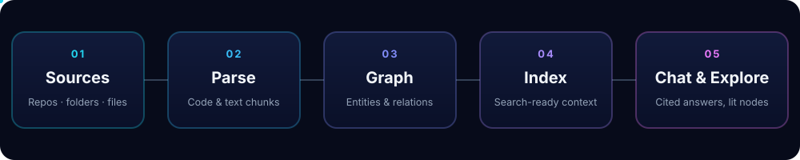
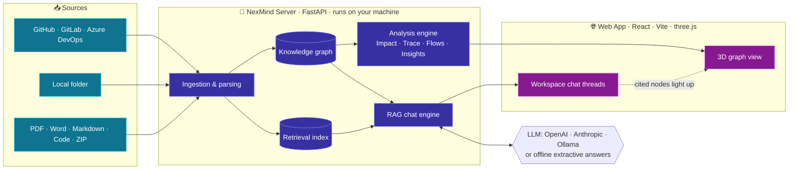
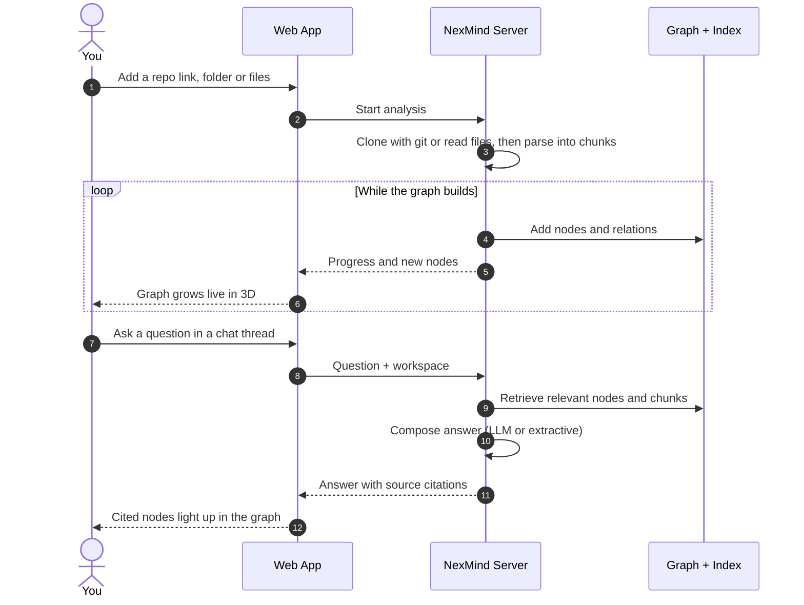
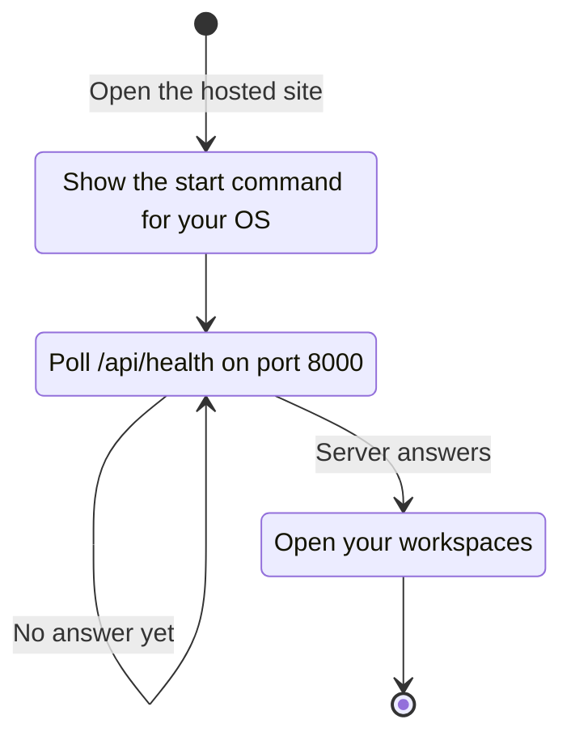
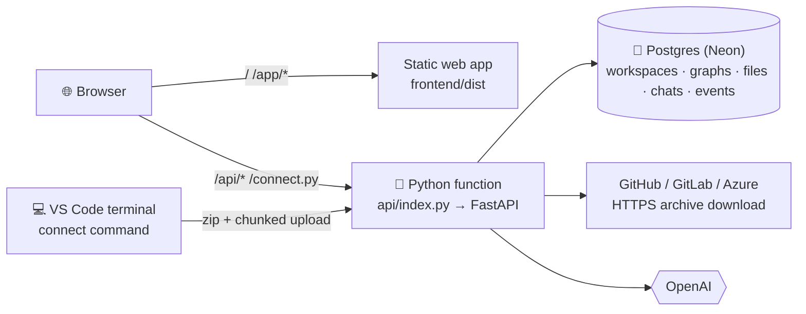

<div align="center">



<a href="https://nexmind-livid.vercel.app">
  
</a>

<br/>


<br/>


<br/><br/>

[**🌐 Live Demo**](https://nexmind-livid.vercel.app) &nbsp;·&nbsp;
[**⚡ Quick Start**](#-quick-start) &nbsp;·&nbsp;
[**✨ Features**](#-features) &nbsp;·&nbsp;
[**🏗️ Architecture**](#️-architecture) &nbsp;·&nbsp;
[**🛠️ Troubleshooting**](#️-troubleshooting)

</div>


## 🧠 About

**NexMind** turns code repositories and documents into a **living 3D knowledge graph** you can explore and talk to.
Point it at a GitHub, GitLab or Azure DevOps repository, a folder on your computer, or a pile of PDFs, Word files, Markdown, source code and zips. NexMind parses everything, links it into a graph of entities and relationships, and lets you **chat with it**: every answer cites its sources and lights up the exact nodes it came from.

It is **local-first**. The Python server runs on your own machine, and the hosted web app simply connects to it, so your code and documents never leave your computer.

<div align="center">
  
</div>

## ✨ Features

<table>
<tr>
<td width="33%" valign="top">

### 📥 Analyze anything
GitHub / GitLab / Azure DevOps repos (private ones with an access token), a local folder, or uploaded **PDF, Word, Markdown, code and ZIP** files.

</td>
<td width="33%" valign="top">

### 🌌 Live 3D graph
Watch the graph **grow in real time** while it builds. Hover for a summary; click for code or text, relations, flows and explanations.

</td>
<td width="33%" valign="top">

### 💬 Cited chat
Separate **chat threads per workspace**. Answers cite their sources and **highlight the nodes** they came from.

</td>
</tr>
<tr>
<td valign="top">

### 💥 Impact
See **what depends on** any file, function or concept before you change it.

</td>
<td valign="top">

### 🔗 Trace &amp; Flows
**Trace** how two things connect, and **play a call path** step by step through the graph.

</td>
<td valign="top">

### 🔍 Insights
Spot **circular imports, hub nodes and dead code** automatically.

</td>
</tr>
<tr>
<td valign="top">

### 🤖 Bring your own LLM
OpenAI, Anthropic or local **Ollama**. No key? You still get **offline extractive answers**.

</td>
<td valign="top">

### 🔒 Local-first &amp; private
The server runs on `127.0.0.1`. The hosted site only talks to **your** machine.

</td>
<td valign="top">

### 🚀 Zero-config deploy
The web app is a static site: deploy the `frontend` folder to **Vercel** with no environment variables.

</td>
</tr>
</table>

### 🗂️ Workspace modes

Each workspace starts by choosing what it is for:

| Mode | Input | Best for |
| :--- | :--- | :--- |
| 🧩 **Projects** | GitHub / GitLab links, project ZIPs | Code analysis: structure, dependencies, impact, flows |
| 📚 **Documents** | PDFs, Word, Markdown, ZIPs | Study and general RAG over your documents |
| 🔌 **Live connect** | A command run in your VS Code terminal | Connecting the project you have open to your local server and building its graph live |


## 🏗️ Architecture



### 🔄 From source to cited answer



### 🔌 How the hosted site reaches your server

The hosted page cannot run Python, so it connects to the server on **your** computer:




## 🧰 Tech Stack

| Layer | Technology | Role |
| :--- | :--- | :--- |
| **Backend** |   | Local API server on `127.0.0.1:8000`; also serves a built copy of the web app |
| **CLI** | `nexmind serve` · `nexmind doctor` | Start the server; check Python, packages, git and port |
| **Ingestion** |  + file parsers | Clone repos; read PDF, Word, Markdown, code and ZIP |
| **Intelligence** | RAG · Knowledge graph · Retrieval index | Link entities and relations; ground answers in sources |
| **LLM** |    | Optional answer generation; offline extractive fallback |
| **Frontend** |    | Web app, workspaces and chat UI |
| **3D Graph** |  | Interactive 3D knowledge-graph rendering |
| **Hosting** |  | Static SPA deploy of `frontend/` |
| **Testing** |   | 19 backend tests, typecheck, UI tests and end-to-end tests |

## 📁 Project Structure

```text
NexMind/
├── backend/              🐍 FastAPI server + `nexmind` CLI (ships a built copy of the web app)
│   ├── start.ps1         One-shot setup & run (Windows)
│   ├── start.sh          One-shot setup & run (macOS / Linux)
│   ├── tests/            Backend test suite (pytest)
│   └── .env              Your LLM keys & settings (create it, never commit it)
├── frontend/             ⚛️ React + Vite + three.js web app (deploy this to Vercel)
│   └── vercel.json       SPA rewrites → index.html
├── e2e/                  🎭 Playwright end-to-end tests
├── playwright.config.ts
├── DEPLOY.md             Deployment notes
└── PERF_REPORT.md        Performance report
```


## ⚡ Quick Start

### ✅ Prerequisites

| Requirement | Version | Needed for |
| :--- | :--- | :--- |
| Python | **3.10+** | The NexMind server |
| Git | any recent | Importing GitHub / GitLab / Azure DevOps links only |
| Node.js | **20 or 22** | Frontend development and Vercel builds only |
| Browser | Chrome, Edge or Firefox | Using the hosted site (see [Safari note](#️-troubleshooting)) |

### 1️⃣ Clone the repository

```bash
git clone https://github.com/LoganthP/NexMind.git
cd NexMind
```

### 2️⃣ Run everything locally (no hosting needed)

<details open>
<summary><b>🪟 Windows (PowerShell)</b></summary>

Run one command per line (PowerShell 5 cannot run `&&`):

```powershell
cd backend
powershell -ExecutionPolicy Bypass -File .\start.ps1
```
</details>

<details open>
<summary><b>🍎 macOS / 🐧 Linux</b></summary>

```bash
cd backend
./start.sh
```
</details>

The first run creates a virtual environment and installs everything (a few minutes). Then open **http://127.0.0.1:8000** 🎉

**Already installed?** Use the short form from the `backend` folder:

```bash
pip install -e .
nexmind serve          # start the server
nexmind doctor         # check Python, packages, git and port
```

### 3️⃣ Connect an LLM (optional)

Create `backend/.env` and add a provider. Without one, NexMind still works with offline extractive answers.

```env
# Choose one provider (or none for offline extractive answers)
OPENAI_API_KEY=sk-...
# ANTHROPIC_API_KEY=sk-ant-...
# OLLAMA_BASE_URL=http://localhost:11434

# Optional hardening: only accept requests from your deployed site
NEXMIND_CORS_ORIGINS=https://nexmind-livid.vercel.app
```

### 4️⃣ Develop the web app (hot reload)

Keep the backend running in one terminal, then in another:

```powershell
cd frontend
npm install
npm run dev
```

Open **http://localhost:5173**. The page finds the backend by itself.


## 🚀 Deploy to Vercel

The whole product (web app **and** API) deploys as **one Vercel project** from the repository root. The API runs as a Python function (`api/index.py`); the web app is served as static files.



### One-time setup

| Step | Where | What to do |
| :--- | :--- | :--- |
| 1 | Vercel → Project → **Settings → General** | **Root Directory: `./`** (the repository root, **not** `frontend`). **Framework Preset: Other**. Leave build/output commands empty — `vercel.json` sets them. |
| 2 | Vercel → **Storage** | **Create Database → Neon (Postgres)**, free plan, and **connect it to this project** (all environments). This adds `DATABASE_URL` automatically. |
| 3 | Settings → **Environment Variables** | `OPENAI_API_KEY` = your key (optional: `NEXMIND_LLM_MODEL`, default `gpt-4o-mini`). |
| 4 | Deployments | **Redeploy** (or push a commit). Open `https://<your-site>/api/health`: it must show `"hosted": true` and `"dialect": "postgres"` with `"setup_required": null`. |

> [!IMPORTANT]
> Without step 2 the app refuses to create workspaces and tells you to add the database: Vercel functions have no permanent disk, so anything else would silently lose your data.

### What changes on the hosted version

| Feature | Hosted (Vercel) | On your computer (`nexmind serve`) |
| :--- | :--- | :--- |
| Storage | Postgres (files, graphs, chats) | SQLite + your disk |
| Repo links | HTTPS archive download (public, or private with a token) | Same (falls back to `git`) |
| Large uploads | Sent in 3.5 MB chunks (Vercel limit is 4.5 MB per request) | Same |
| Live progress | Event feed + streamed build (no WebSockets on Vercel) | Same |
| Local folder tab / folder browser | Hidden: a website cannot read your disk. Use **Upload project folder** or **Live connect** | Available |
| Live connect | The command zips the folder, uploads it and re-uploads on every change | The server watches the folder in place |
| Privacy | Each browser gets its own private key and sees only its own workspaces | Single user |

### Live connect from VS Code (hosted)

Open your project in VS Code, open the terminal (<kbd>Ctrl</kbd> + <kbd>`</kbd>) and paste the command shown in **New workspace → Live connect**. It looks like:

```powershell
irm "https://<your-site>/connect.py?k=<your-browser-key>" | python - .
```

It needs only Python 3.8+. Keep the terminal open for live sync (<kbd>Ctrl</kbd>+<kbd>C</kbd> stops it); add `--no-watch` to index once.

### Limits (hosted)

- Uploads: 120 MB per file (`NEXMIND_MAX_UPLOAD_MB`), 30 workspaces per browser (`NEXMIND_MAX_WORKSPACES`).
- One graph build may take up to 300 s (Vercel Hobby maximum). Very large repositories: index a sub-folder such as `src`.
- Live connect uploads source files up to 2 MB each and 100 MB in total, skipping `node_modules`, `.git`, build output and binaries.


## 🧪 Testing

```powershell
# Backend, local mode (SQLite, background jobs)
cd backend
pip install -r requirements-dev.txt
python -m pytest tests -q

# Backend, hosted mode exactly as on Vercel (embedded Postgres, no background threads, per-browser isolation)
python -m pytest tests_hosted -q

# Frontend: types, unit/UI tests, production build
cd ..\frontend
npm ci
npm run typecheck
npm test
npm run build
```

Optional full-stack check of the real frontend modules against any running hosted deployment:

```powershell
$env:NEXMIND_LIVE_API = "https://<your-site>"
npx vitest run src/__tests__/hosted.live.test.ts
```

## 🛠️ Troubleshooting

<details>
<summary><b>⬜ I see a blank page</b></summary>

1. Open the browser console (**F12**). A crash now shows a readable card instead of a blank screen; copy its message.
2. Check that http://127.0.0.1:8000/api/health returns `"app":"nexmind"`.
3. Replace an old `frontend` folder completely (delete it first) so stale files do not mix with the new version.
4. Run `npm install` again after replacing it, and use `npm run typecheck` to catch TypeScript errors early.
</details>

<details>
<summary><b>🧭 Safari won't connect</b></summary>

Safari blocks https pages from calling local servers. Use Chrome, Edge or Firefox, or open **http://127.0.0.1:8000** directly.
</details>

<details>
<summary><b>🔐 Chrome asks about local network access</b></summary>

Choose **Allow**. The hosted site needs it to reach the server on your own machine.
</details>

<details>
<summary><b>🔌 Port 8000 is already in use</b></summary>

Run `nexmind serve --port 8001`, then enter `http://127.0.0.1:8001` on the connect screen. `nexmind doctor` also checks the port for you.
</details>

<details>
<summary><b>📦 Importing a repo link fails</b></summary>

Repositories are downloaded over HTTPS (no `git` needed). "Not found, or it is private" means the URL or branch is wrong, or the repository needs an access token with read access.
</details>

<details>
<summary><b>☁️ Vercel: "Storage is not set up yet"</b></summary>

Add a Postgres database in **Vercel → Storage** (Neon, free), connect it to the project for all environments, then redeploy. Check `https://<your-site>/api/health`.
</details>

<details>
<summary><b>☁️ Vercel: the site loads but every action fails</b></summary>

Open `https://<your-site>/api/health`. A 404 means the Root Directory is still `frontend`: set it to `./` and Framework Preset to **Other**, then redeploy. Function logs are under **Deployments → (latest) → Functions**.
</details>


